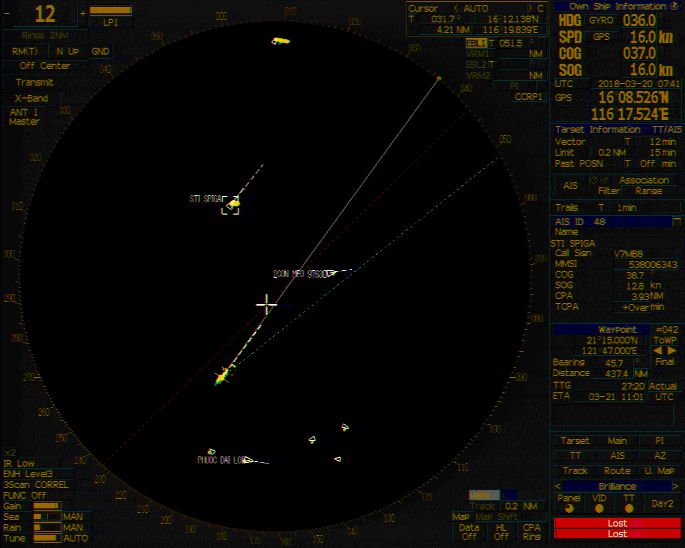
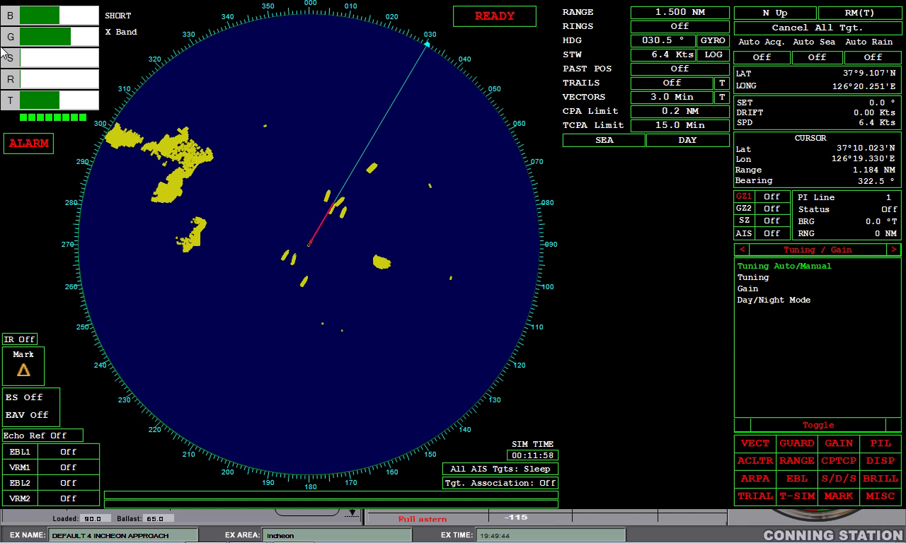
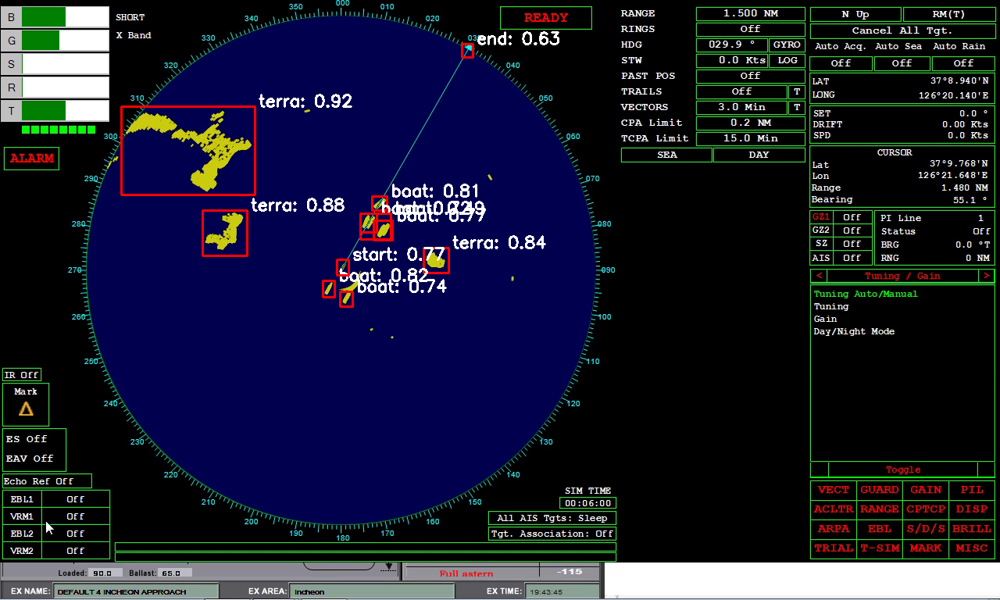

# Radar Object Detection

[한국어](./README_ko.md)

> **Portfolio Project** — A computer vision project for detecting objects on marine radar screens.

## Overview

This project detects objects such as vessels in real-time from radar imagery.
While radar UIs vary across devices, the project handles multiple radar types by converting raw LabelMe annotations to a unified YOLO format with stratified sampling, then performs detection with a YOLO model.

### Data

Two types of radar data are used. Although the UIs differ, the circular scan area shares the same structure.

| Radar Type 1 | Radar Type 2 |
|:---:|:---:|
|  |  |

### Detection Classes

| Class | Description |
|-------|-------------|
| `boat_rectangle` | Rectangular vessel |
| `boat_triangle` | Triangular vessel |
| `start` | Start marker |
| `end` | End marker |

## Method

The preprocessing pipeline converts raw annotated data into a YOLO-compatible dataset:

### 1. Annotation Conversion

LabelMe JSON annotations are converted to YOLO format. Class labels are standardized (typo correction, name unification) and bounding box coordinates are normalized to `(class_id, x_center, y_center, width, height)`.

### 2. Stratified Split

Data is split into train/valid/test sets (default 80/10/10) with stratified sampling by radar type, ensuring each split has balanced representation from all radar sources.

## Result



## Project Structure

```
.
├── src/
│   ├── train_model.py                          # Training pipeline
│   ├── inference.py                            # Inference pipeline
│   ├── yolo26n.pt                              # Pre-trained YOLO26 Nano weights
│   ├── yolo26m.pt                              # Pre-trained YOLO26 Medium weights
│   ├── yaml/
│   │   ├── radar_config.yaml                   # Training/inference/preprocessing config
│   │   └── radar_dataset.yaml                  # Dataset definition (auto-updated)
│   ├── utils/
│   │   ├── train/
│   │   │   └── pre_process_modules.py          # Preprocessing (LabelMe→YOLO conversion, stratified split)
│   │   ├── inference/
│   │   │   └── inference_modules.py            # Inference modules (model loading, coordinate inverse-transform)
│   │   └── common/
│   │       ├── project_paths.py                # Path utilities
│   │       ├── video_frame_extractor.py        # Video frame extraction for data collection
│   │       ├── random_rotate.py                # Random rotation augmentation
│   │       └── save_json.py                    # JSON saving
│   └── test_inference/
│       ├── test_inference.py                   # Inference unit test
│       └── test_data/                          # Test images
├── data/                                       # Raw & processed data (git-ignored)
│   ├── radar1/                                 # Raw radar type 1 (PNG + LabelMe JSON)
│   ├── radar2/                                 # Raw radar type 2
│   └── train_data/raw_stratified/              # Processed YOLO dataset (train/valid/test)
├── runs/detect/                                # Training run outputs (weights, metrics, plots)
├── sample_images/                              # README images
├── pyproject.toml
└── README.md
```

## Setup

```bash
# Install uv (if not installed)
curl -LsSf https://astral.sh/uv/install.sh | sh

# Install dependencies
uv sync
```

### Requirements

- Python >= 3.11
- CUDA GPU (recommended for training)

## Usage

### Preprocessing

Converts raw LabelMe annotations into a YOLO-format dataset with stratified train/valid/test split.

```bash
# Run preprocessing standalone
uv run python src/utils/train/pre_process_modules.py
```

This reads from `data/radar1/` and `data/radar2/`, and outputs to `data/train_data/raw_stratified/`.

### Training

```bash
uv run python src/train_model.py
```

By default, preprocessing is skipped (assumes data is already prepared). To run preprocessing before training, edit `src/train_model.py` and set `main(run_pre_process=True)`.

Training configuration is in `src/yaml/radar_config.yaml`:

```yaml
train_conf:
  model: yolo26n.pt       # YOLO model (yolo26n.pt or yolo26m.pt)
  epochs: 1000
  batch_size: 512
  image_size: 320
  device: 0               # GPU ID or cpu
  patience: 100           # Early stopping patience
```

### Inference

```bash
uv run python src/inference.py
```

Inference configuration is also in `src/yaml/radar_config.yaml`:

```yaml
inference:
  data_dir: data/origin/old_radar
  weight: weights/best.pt
  circle_info_dir: circle_coordinate/circle_coordinates_default.json
  save: True
  save_dir: result/radar
```

Output includes labeled images with bounding boxes and JSON files with detection coordinates.

## Tech Stack

- **Object Detection**: [Ultralytics YOLO](https://github.com/ultralytics/ultralytics)
- **Image Processing**: OpenCV
- **Labeling**: [LabelMe](https://github.com/wkentaro/labelme)
- **Package Management**: [uv](https://github.com/astral-sh/uv)
