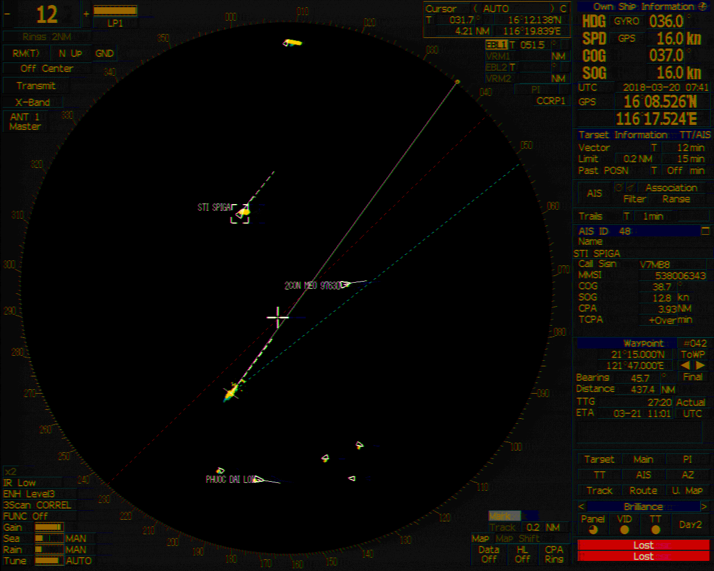
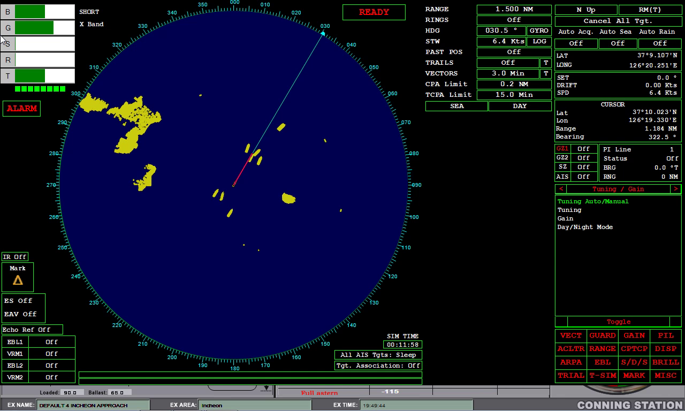
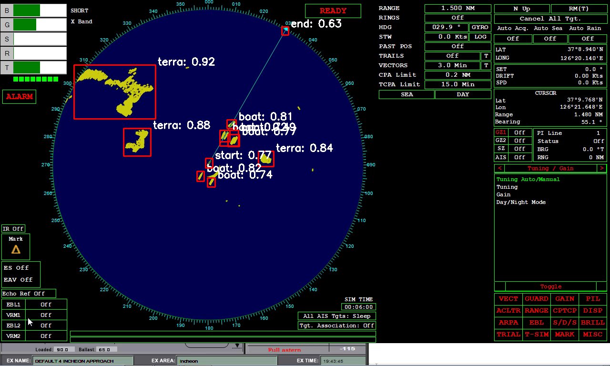

# Radar Object Detection

[English](./README.md)

> **Portfolio Project** — 선박용 레이더 화면에서 객체를 탐지하는 컴퓨터 비전 프로젝트입니다.

## Overview

레이더 영상에서 선박 등의 객체를 실시간으로 탐지합니다.
레이더 UI는 기종마다 다르지만, 여러 레이더 타입의 LabelMe 어노테이션을 통합된 YOLO 형식으로 변환하고 층화추출로 균형 잡힌 데이터셋을 구성하여 YOLO 모델로 탐지를 수행합니다.

### Data

두 종류의 레이더 데이터를 사용합니다. UI는 다르지만 원형 스캔 영역은 동일한 구조입니다.

| Radar Type 1 | Radar Type 2 |
|:---:|:---:|
|  |  |

### Detection Classes

| Class | Description |
|-------|-------------|
| `boat_rectangle` | 사각형 선박 |
| `boat_triangle` | 삼각형 선박 |
| `start` | 시작 마커 |
| `end` | 종료 마커 |

## Method

전처리 파이프라인은 원본 어노테이션 데이터를 YOLO 호환 데이터셋으로 변환합니다:

### 1. Annotation Conversion

LabelMe JSON 어노테이션을 YOLO 형식으로 변환합니다. 클래스 레이블을 표준화(오타 수정, 이름 통일)하고, bbox 좌표를 `(class_id, x_center, y_center, width, height)`로 정규화합니다.

### 2. Stratified Split

레이더 타입별 층화추출로 train/valid/test 세트를 분할합니다 (기본 80/10/10). 모든 분할에 각 레이더 타입이 균형 있게 포함되도록 합니다.

## Result



## Project Structure

```
.
├── src/
│   ├── train_model.py                          # 학습 파이프라인
│   ├── inference.py                            # 추론 파이프라인
│   ├── yolo26n.pt                              # 사전 학습 YOLO26 Nano 가중치
│   ├── yolo26m.pt                              # 사전 학습 YOLO26 Medium 가중치
│   ├── yaml/
│   │   ├── radar_config.yaml                   # 학습/추론/전처리 설정
│   │   └── radar_dataset.yaml                  # 데이터셋 정의 (자동 갱신)
│   ├── utils/
│   │   ├── train/
│   │   │   └── pre_process_modules.py          # 전처리 (LabelMe→YOLO 변환, 층화 분할)
│   │   ├── inference/
│   │   │   └── inference_modules.py            # 추론 모듈 (모델 로드, 좌표 역변환)
│   │   └── common/
│   │       ├── project_paths.py                # 경로 유틸리티
│   │       ├── video_frame_extractor.py        # 데이터 수집용 영상 프레임 추출
│   │       ├── random_rotate.py                # 랜덤 회전 augmentation
│   │       └── save_json.py                    # JSON 저장
│   └── test_inference/
│       ├── test_inference.py                   # test_data 일괄 추론 스크립트 (유닛 테스트 아님)
│       ├── test_circle_coordinates_old.json    # 샘플 데모용 스캔 원 픽셀 좌표
│       ├── test_data/                          # 테스트 이미지
│       └── test_results/                       # 이전 모델의 과거 결과 (변경하지 않음)
├── tests/
│   └── test_inference_logic.py                 # 결정적 unittest (합성 이미지, 가짜 모델 출력)
├── outputs/                                    # 추론 결과 (git 미추적)
├── data/                                       # 원본 및 가공 데이터 (git 미추적)
│   ├── radar1/                                 # 레이더 타입 1 원본 (PNG + LabelMe JSON)
│   ├── radar2/                                 # 레이더 타입 2 원본
│   └── train_data/raw_stratified/              # YOLO 형식 데이터셋 (train/valid/test)
├── runs/detect/                                # 학습 결과 (가중치, 메트릭, 플롯)
├── sample_images/                              # README 이미지
├── pyproject.toml
└── README.md
```

## Setup

```bash
# uv 설치 (없을 경우)
curl -LsSf https://astral.sh/uv/install.sh | sh

# 의존성 설치
uv sync
```

### Requirements

- Python >= 3.11
- CUDA GPU (학습 시 권장)

## Usage

### Preprocessing

LabelMe 어노테이션을 YOLO 형식으로 변환하고, 층화 train/valid/test 분할을 수행합니다.

```bash
# 전처리 단독 실행
uv run python src/utils/train/pre_process_modules.py
```

`data/radar1/`, `data/radar2/`에서 읽어 `data/train_data/raw_stratified/`로 출력합니다.

### Training

```bash
uv run python src/train_model.py
```

기본적으로 전처리는 건너뜁니다 (데이터가 이미 준비된 것으로 가정). 전처리를 함께 실행하려면 `src/train_model.py`에서 `main(run_pre_process=True)`로 수정하세요.

학습 설정은 `src/yaml/radar_config.yaml`에서 수정합니다:

```yaml
train_conf:
  model: yolo26n.pt       # YOLO 모델 (yolo26n.pt 또는 yolo26m.pt)
  epochs: 1000
  batch_size: 512
  image_size: 320
  device: 0               # GPU ID 또는 cpu
  patience: 100           # Early stopping patience
```

### Inference (공개 샘플 데모)

저장소 루트에서 실행합니다:

```bash
uv run python src/inference.py
```

기본 설정은 저장소에 이미 커밋된 파일만 사용하여 공개 샘플 이미지 1장(`sample_images/radar2.png`)을 처리합니다:

| 입력 | 경로 |
|------|------|
| 이미지 | `sample_images/radar2.png` |
| 체크포인트 | `runs/detect/train4/weights/best.pt` (Ultralytics YOLO26n 파인튜닝, `train4` 실행, `runs/detect/train4/args.yaml` 참고) |
| 스캔 원 | `src/test_inference/test_circle_coordinates_old.json` (`x_centre=438, y_centre=348, radius=339`, 픽셀) |

결과는 git 미추적 폴더 `outputs/inference/`에 저장됩니다:

- `radar2.png.annotated.png` — 원본 해상도 이미지의 복사본에 박스를 그린 결과
- `radar2.png.detections.json` — 사이드카 JSON (탐지가 없어도 `"detections": []`인 유효한 JSON)

처리 과정: 원의 외접 정사각형을 자르고(이미지 안에 완전히 들어오지 않으면 에러), 스캔 원 밖의 픽셀을 0으로 마스킹한 뒤 모델을 실행하고, 박스를 원본 이미지 좌표로 되돌립니다. JSON의 `xyxy_px`는 원본 이미지 기준 **절대 픽셀** 좌표 `(x1, y1, x2, y2)`(crop 오프셋 반영, 이미지 경계로 클리핑)이고, `crop_xyxy_px`는 crop 내부 픽셀 좌표입니다. 0–1 정규화 비율은 저장하지 않습니다. 각 탐지는 `class_id`, `class_name`, `confidence`를 포함합니다.

설정은 `src/yaml/radar_config.yaml`에 있습니다 (상대 경로는 저장소 루트 기준, 절대 경로 허용):

```yaml
inference:
  source: sample_images/radar2.png          # 이미지 파일 또는 폴더
  weight: runs/detect/train4/weights/best.pt
  circle_json: src/test_inference/test_circle_coordinates_old.json  # flat 또는 "old_radar" 중첩
  save: true
  save_dir: outputs/inference
  show: false                               # 창 표시는 명시적으로 켤 때만
  conf: 0.25
  grayscale: false                          # true = 이전 방식(gray->BGR) 모델 입력
```

CLI 옵션: `--source`, `--weights`, `--circle-json`, `--output-dir`, `--conf`, `--config`, `--show`, `--no-save`.

헤드리스 동작: 기본적으로 창을 띄우지 않으므로 SSH/CI 환경에서도 동작합니다. `--show`는 선택 사항이며 GUI 지원 OpenCV와 디스플레이가 필요하고, 저장 여부와는 무관합니다. 파일 누락, 읽을 수 없거나 빈 이미지, 빈 입력 폴더, 이미지 밖으로 벗어나는 원 좌표는 에러 메시지와 종료 코드 2를 반환합니다. 체크포인트가 없으면 절대 자동 다운로드하거나 재학습하지 않습니다.

한계:

- 공개 샘플 이미지 1장에 대한 데모입니다. 원 좌표 JSON은 해당 레이더 레이아웃/해상도 전용이며, 다른 이미지는 별도의 원 좌표가 필요합니다.
- 커밋된 체크포인트는 YOLO26 모델입니다. 이전 포트폴리오에 소개된 YOLOv5 모델이 아니며 그 결과를 재현한다고 주장하지 않습니다. 여기서는 정확도 지표를 제시하지 않습니다.
- `src/test_inference/test_results/`는 클래스 구성이 다른 이전 모델의 과거 결과이며 참고용으로 그대로 둡니다. `uv run python src/test_inference/test_inference.py`는 현재 파이프라인으로 `test_data/`를 처리해 `outputs/test_inference/`에 저장합니다.

### Tests

```bash
uv run python -m unittest discover -s tests -v
```

경로 해석, 원 좌표 검증/자르기, 픽셀 좌표 변환/클리핑, 저장 로직에 대한 결정적 유닛 테스트입니다. 임시 합성 이미지와 가짜 모델 출력만 사용하며, 실제 모델 추론을 실행하지 않고 탐지 품질에 대해서도 아무것도 보장하지 않습니다.

## Tech Stack

- **Object Detection**: [Ultralytics YOLO](https://github.com/ultralytics/ultralytics)
- **Image Processing**: OpenCV
- **Labeling**: [LabelMe](https://github.com/wkentaro/labelme)
- **Package Management**: [uv](https://github.com/astral-sh/uv)
