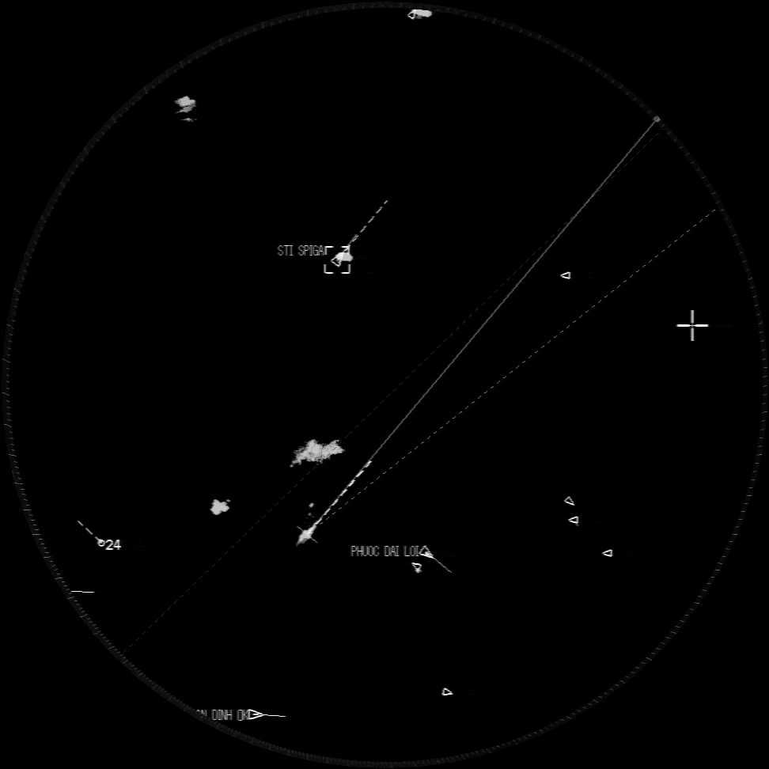

# Radar Object Detection

[English](./README.md)

> **Portfolio Project** — 선박용 레이더 화면에서 객체를 탐지하는 컴퓨터 비전 프로젝트입니다.

## Overview

레이더 영상에서 선박 등의 객체를 실시간으로 탐지합니다.
레이더 UI는 기종마다 다르지만 원형 스캔 영역은 공통적이므로, Hough Circle Transform으로 원형 영역을 추출한 뒤 YOLO 모델로 탐지를 수행합니다.

### Data

두 종류의 레이더 데이터를 사용합니다. UI는 다르지만 원형 스캔 영역은 동일한 구조입니다.

| Radar Type 1 | Radar Type 2 |
|:---:|:---:|
|  |  |

### Detection Classes

| Class | Description |
|-------|-------------|
| `boat_rectangle` | 사각형 선박 |
| `boat_triangle` | 삼각형 선박 |
| `start` | 시작 마커 |
| `end` | 종료 마커 |

## Method

레이더 화면을 그대로 학습하면 UI 요소가 노이즈로 작용하여 성능이 저하됩니다.
이를 해결하기 위해 다음과 같은 전처리 파이프라인을 설계했습니다.

### 1. Circle Extraction

여러 이미지에 대해 Hough Circle Transform을 적용하고, 이상치를 1-sigma 필터링한 뒤 평균 파라미터로 원형 스캔 영역만 crop합니다.



### 2. Grayscale Conversion

동일 레이더라도 시간대에 따라 UI 색상이 변하므로, grayscale로 변환하여 색상 변화에 강건하게 만듭니다.

### 3. Coordinate Transform

- **학습 시**: LabelMe bbox 좌표를 YOLO 형식으로 변환하고, crop된 원형 영역 기준 좌표계로 변환
- **추론 시**: 탐지 결과 좌표에 원형 영역 오프셋을 더해 원본 이미지 좌표로 역변환

## Result


## Project Structure

```
.
├── src/
│   ├── train_model.py                          # 학습 파이프라인
│   ├── inference.py                            # 추론 파이프라인
│   ├── yolo26n.pt                              # 사전 학습 YOLO26 Nano 가중치
│   ├── yolo26m.pt                              # 사전 학습 YOLO26 Medium 가중치
│   ├── yaml/
│   │   ├── radar_config.yaml                   # 학습/추론/전처리 설정
│   │   └── radar_dataset.yaml                  # 데이터셋 정의 (자동 갱신)
│   ├── utils/
│   │   ├── train/
│   │   │   └── pre_process_modules.py          # 전처리 (원형 추출, LabelMe→YOLO, 층화 분할)
│   │   ├── inference/
│   │   │   └── inference_modules.py            # 추론 모듈 (모델 로드, 좌표 역변환)
│   │   └── common/
│   │       ├── project_paths.py                # 경로 유틸리티
│   │       ├── video_frame_extractor.py        # 데이터 수집용 영상 프레임 추출
│   │       ├── random_rotate.py                # 랜덤 회전 augmentation
│   │       └── save_json.py                    # JSON 저장
│   └── test_inference/
│       ├── test_inference.py                   # 추론 유닛 테스트
│       └── test_data/                          # 테스트 이미지
├── data/                                       # 원본 및 가공 데이터 (git 미추적)
│   ├── radar1/                                 # 레이더 타입 1 원본 (PNG + LabelMe JSON)
│   ├── radar2/                                 # 레이더 타입 2 원본
│   └── train_data/raw_stratified/              # YOLO 형식 데이터셋 (train/valid/test)
├── runs/detect/                                # 학습 결과 (가중치, 메트릭, 플롯)
├── sample_images/                              # README 이미지
├── pyproject.toml
└── README.md
```

## Setup

```bash
# uv 설치 (없을 경우)
curl -LsSf https://astral.sh/uv/install.sh | sh

# 의존성 설치
uv sync
```

### Requirements

- Python >= 3.11
- CUDA GPU (학습 시 권장)

## Usage

### Preprocessing

LabelMe 어노테이션을 원형 추출, grayscale 변환, 층화 train/valid/test 분할을 거쳐 YOLO 형식 데이터셋으로 변환합니다.

```bash
# 전처리 단독 실행
uv run python src/utils/train/pre_process_modules.py
```

`data/radar1/`, `data/radar2/`에서 읽어 `data/train_data/raw_stratified/`로 출력합니다.

### Training

```bash
uv run python src/train_model.py
```

기본적으로 전처리는 건너뜁니다 (데이터가 이미 준비된 것으로 가정). 전처리를 함께 실행하려면 `src/train_model.py`에서 `main(run_pre_process=True)`로 수정하세요.

학습 설정은 `src/yaml/radar_config.yaml`에서 수정합니다:

```yaml
train_conf:
  model: yolo26n.pt       # YOLO 모델 (yolo26n.pt 또는 yolo26m.pt)
  epochs: 1000
  batch_size: 512
  image_size: 320
  device: 0               # GPU ID 또는 cpu
  patience: 100           # Early stopping patience
```

### Inference

```bash
uv run python src/inference.py
```

추론 설정도 `src/yaml/radar_config.yaml`에서 수정합니다:

```yaml
inference:
  data_dir: data/origin/old_radar
  weight: weights/best.pt
  circle_info_dir: circle_coordinate/circle_coordinates_default.json
  save: True
  save_dir: result/radar
```

바운딩 박스가 그려진 이미지와 탐지 좌표가 담긴 JSON 파일이 출력됩니다.

## Tech Stack

- **Object Detection**: [Ultralytics YOLO](https://github.com/ultralytics/ultralytics)
- **Image Processing**: OpenCV (Hough Circle Transform, grayscale conversion)
- **Labeling**: [LabelMe](https://github.com/wkentaro/labelme)
- **Package Management**: [uv](https://github.com/astral-sh/uv)
